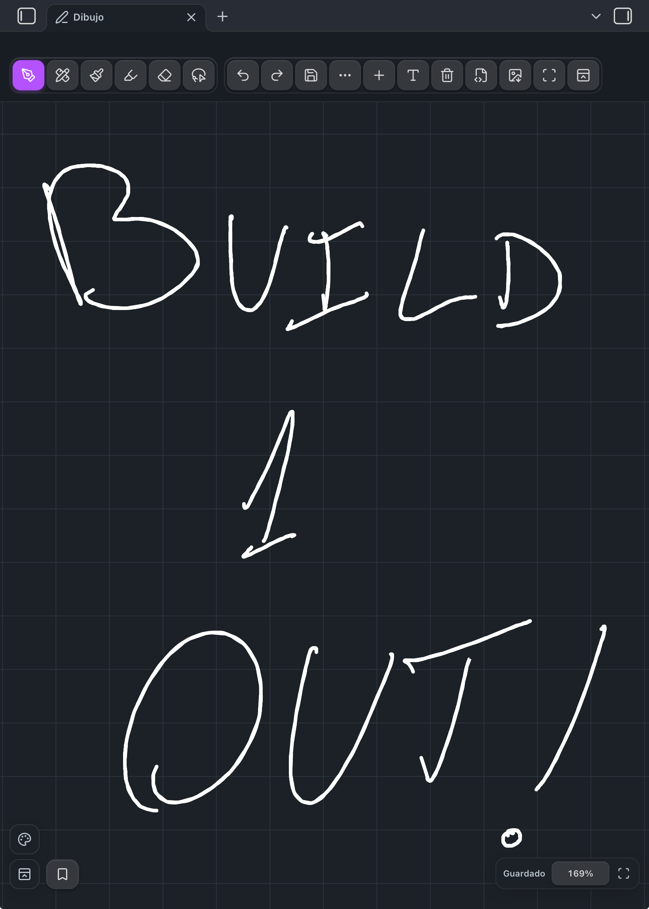
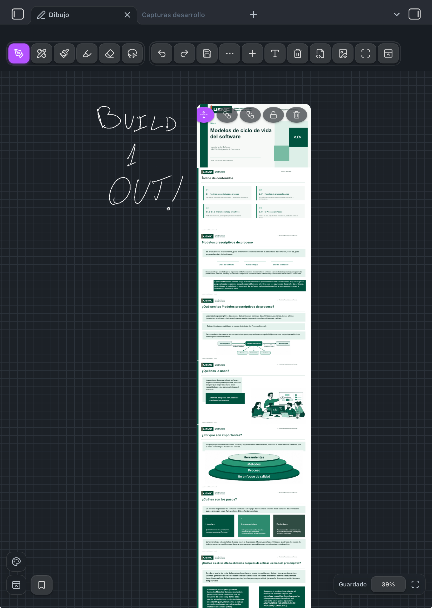
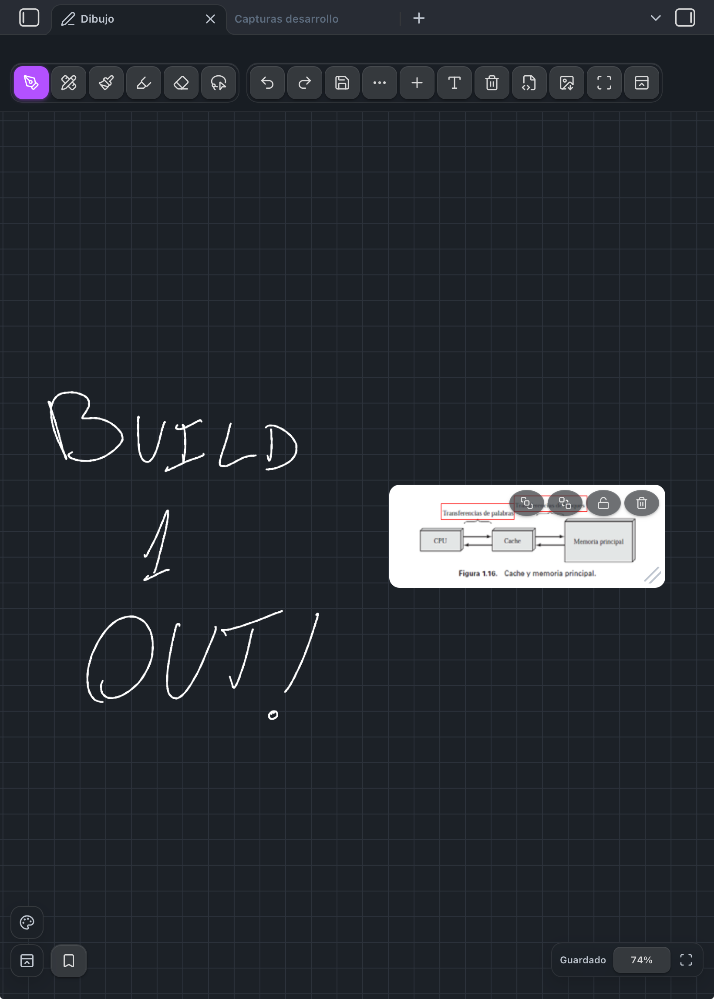
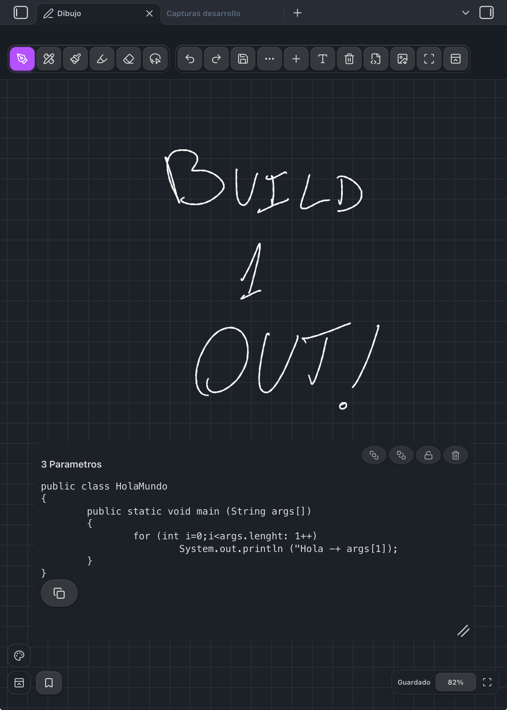

# Inkpad

Inkpad is a Pencil-first infinite drawing canvas for Obsidian. It stores each drawing as a portable `.ink` file in your vault, so your existing sync solution—including Remotely Save—remains in control.

> **Status:** Inkpad 1.0.3 is the current public release. It is built for iPadOS with Apple Pencil and also supports Windows, macOS and Linux.

## What it does

- Draw on an infinite canvas with pen, pencil, marker, highlighter, shapes and a destructive partial eraser.
- Pan with one finger and zoom with a two-finger pinch on iPad; use middle-mouse drag and wheel/trackpad zoom on desktop.
- Select, move, recolour, duplicate, link, export or delete groups of strokes with the lasso.
- Place vault Markdown notes, PDFs, images, audio and text cards on the canvas, then annotate over them.
- Render every PDF page locally, without modifying the source PDF.
- Save named viewport bookmarks, fit all content to the screen and export ink as SVG or PNG.
- Keep drawings as ordinary JSON files that are easy to back up, version and sync.

## Why Inkpad

Inkpad keeps the input path deliberately small: Pointer Events, coalesced samples when available, Canvas 2D and no framework layer between the pen and the pixels. Completed ink is cached for responsive navigation in long study notes, while the active stroke remains vector-drawn immediately above that cache.

The plugin does not use a cloud service, telemetry, analytics or a database. It only reads and writes the `.ink` file you open or create and references assets already inside the vault.

## In action

<p align="center">
  
  
</p>
<p align="center">
  
  
</p>

Handwriting, extended PDFs, images, and Markdown notes can live together on the same infinite canvas.

## Installation

### Community plugins

Once accepted into the Obsidian Community directory, install **Inkpad** from **Settings → Community plugins**.

### Manual / beta installation

1. Download `main.js`, `manifest.json` and `styles.css` from the latest GitHub release.
2. Create `<vault>/.obsidian/plugins/inkpad/`.
3. Put those three files in that folder.
4. Reload Obsidian and enable **Inkpad** under Community plugins.

For beta testing, add this repository to [BRAT](https://github.com/TfTHacker/obsidian42-brat).

## Quick start

1. Run **Inkpad: Crear dibujo infinito** from the command palette, or select the pen icon in the ribbon.
2. Write with Apple Pencil or a mouse. On iPad, use one finger to pan and pinch with two fingers to zoom.
3. Use **＋** to place a vault file or **T** to add a text card.
4. Tap the save button before manually triggering sync if you want an immediate write.

## Interaction reference

| Action | iPadOS | Desktop |
| --- | --- | --- |
| Draw | Apple Pencil | Primary mouse button |
| Pan | One finger | Middle-mouse drag |
| Zoom | Two-finger pinch | Wheel or trackpad pinch |
| Open tools | Toolbar or floating palette | Toolbar, floating palette or shortcuts |
| Fit content | Frame icon | Frame icon or `F` |
| Reset zoom | Tap zoom percentage | Tap zoom percentage or `0` |

Desktop shortcuts: `P` pen, `B` pencil, `M` marker, `H` highlighter, `E` eraser, `L` lasso, `F` fit content, `0` reset zoom, `Ctrl/Cmd+Z` undo and `Ctrl/Cmd+Shift+Z` redo.

## Sync and data safety

Each drawing is a single `*.ink` JSON file. Inkpad debounces writes and serializes them through Obsidian's vault API, which keeps it compatible with file-based synchronizers such as Remotely Save.

Avoid editing the same drawing on two devices before they have synchronized. If Inkpad sees an external change while local input is pending, it refuses to overwrite it and asks you to reload. Invalid or incomplete incoming files are never replaced with an empty drawing.

## PDFs and vault content

PDF pages are rasterized locally using PDF.js and shown inside a movable card. Images preserve their aspect ratio. Delete, lock, resize and reorder controls affect only the canvas card; the original vault file is never changed.

For smooth handwriting, embedded content is view-only while it sits on the canvas. Open the original note or PDF normally when you need to edit or scroll it.

## Apple Pencil note

Inkpad handles standard web pen input and side-button signals when iPadOS exposes them to the Obsidian WebView. Apple Pencil double-tap and Apple Pencil Pro squeeze are UIKit-only gestures, so a community plugin running in Obsidian cannot receive or replicate the native Apple Notes Pencil menu.

## Development

```bash
npm install
npm test
npm run test:performance
npm run build
```

Copy `main.js`, `manifest.json` and `styles.css` into `<vault>/.obsidian/plugins/inkpad/`, reload Obsidian and enable the plugin. `npm run build` produces one self-contained `main.js`, including the PDF renderer, because Community Plugin releases install only the standard plugin assets.

## Release process

The GitHub Actions workflow runs tests and builds the plugin whenever a semantic-version tag such as `1.0.0` is pushed. It publishes `main.js`, `manifest.json` and `styles.css` as release assets—the exact files Obsidian installs.

## Privacy

Inkpad makes no network requests and collects no telemetry. PDF parsing, drawing and export all happen locally.

## License

[MIT](LICENSE)

PDF rendering uses Mozilla PDF.js under Apache-2.0; see [third-party notices](THIRD_PARTY_NOTICES.md).
